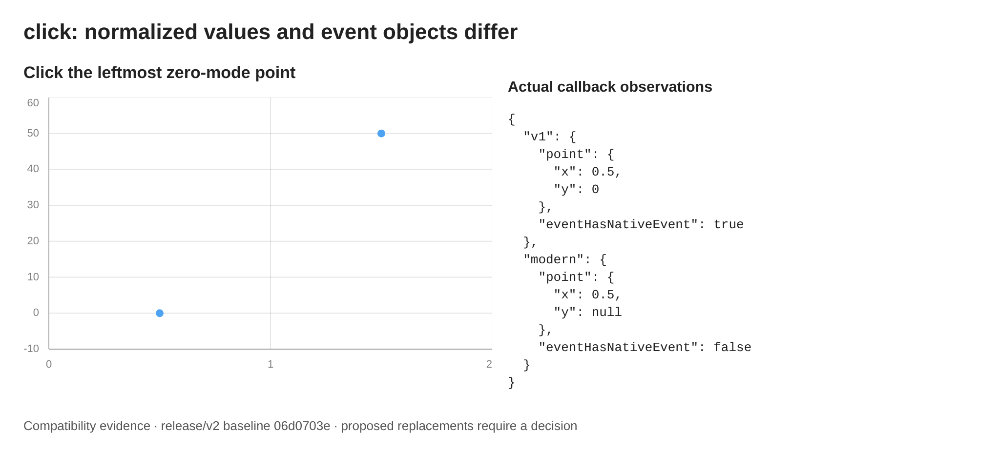
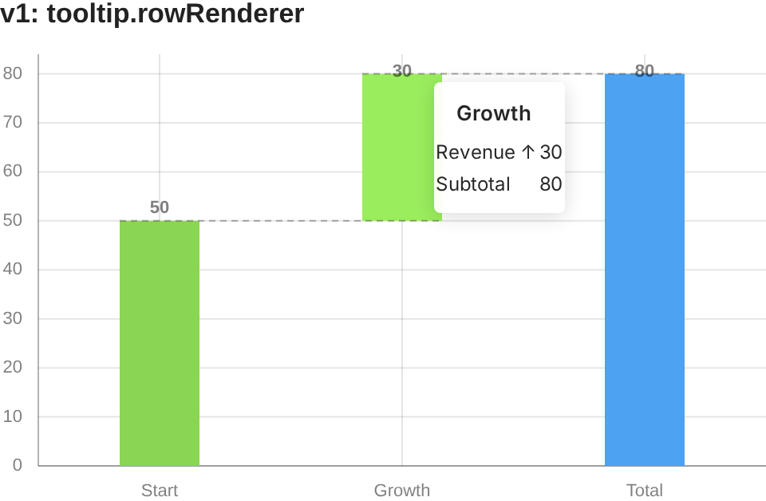
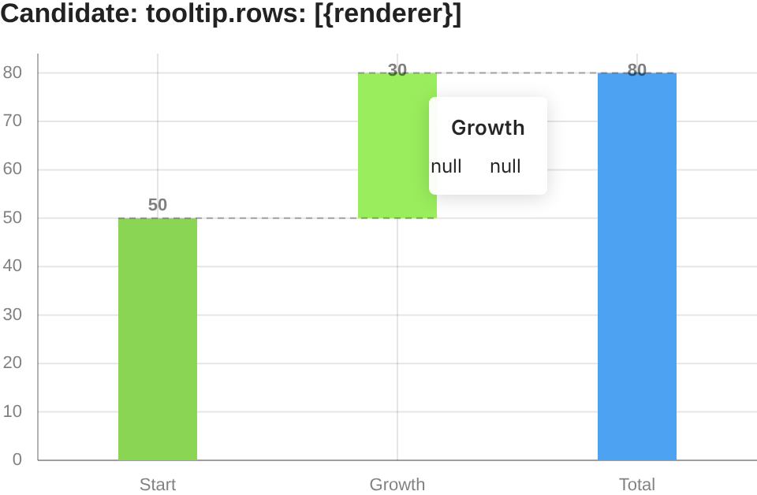

# V2 compatibility decisions

These cases need a decision before removing the remaining deprecated API. They are reproducible issue drafts, not announcements that support has ended. The baseline is v1.70.0 / `06d0703e`; the comparison shows the existing replacement APIs on that baseline, not a finished v2 implementation.

The current migration removes `ticks.pixelInterval`, numeric `unit`, and Bar-X/Bar-Y `dataLabels.inside`. The isolated v1 adapter converts those options and `maxPadding`, and returns diagnostics. The click and tooltip cases below remain unchanged. See [Migrating from v1 to v2](./migration-v2.md) for usage.

For each case, choose either equivalent behavior through explicit configuration and the adapter, or an explicit decision to discontinue the listed behavior. A confirmed bug can be excluded from compatibility, but its unsupported behavior and replacement still need release documentation.

## Axis padding: separate change targeting main

The v1 adapter converts `maxPadding: 0.25` to `padding.max: '25%'`, preserving an explicitly configured `padding.max`. This conversion depends on [the companion change targeting `main`](https://github.com/gravity-ui/charts/pull/806), which applies both percentage boundaries using the same initial scale, before band offsets, label space and tick rounding. Do not release the adapter with the former percentage-fitting implementation.

The comparison covered linear, logarithmic and datetime scales, reversed axes, rounding, zoom, split plots, and responsive bar label space. A one-time conversion to a fraction of the final visible length could not preserve every layout; the companion change retains the original linear and datetime calculation instead. Pixel and automatic padding remain visual-space requests. There is no migration-specific code in plugins or the scale implementation.

The companion change leaves the existing `maxPadding` calculation untouched. New percentage `padding.min/max` extends logarithmic ranges symmetrically in log coordinates. Consequently the polyfill's logarithmic conversion intentionally does not preserve the old orientation-dependent limits; it returns `axis-max-padding-logarithmic` so applications can show the change to users. This is a documented exception for the old bug, not a promise of exact logarithmic compatibility.

The exclusion for explicit Y-axis `timestamps` and existing datetime-label formatting remain unchanged. An omitted `padding.max` still uses the legacy field/default; explicit percentages opt into the new calculation.

Regression coverage for the companion change lives in `src/core/scales/__tests__/axis-padding-compat.test.ts`. The polyfill tests cover field conversion, explicit-option precedence, diagnostics, immutability and overlapping nested conversions.

## Preserve the legacy click contract

**Status:** unresolved compatibility gap. The click default and legacy callback fields remain unchanged in this change.

**Reproduce:** use scatter with `nullMode: 'zero'` and a point `{x: 0.5, y: null}`. Click the drawn point and compare `payload.point` with `payload.chart.getClosest(payload.position, {mode: 'tooltip'})?.point`. Also inspect the second callback argument and `payload.event`.

**Observed:** legacy `point.y` is `0`; the modern point retains `null`. The actual second argument is a React event with `nativeEvent`, whereas `payload.event` is the native event. Its declared `PointerEvent` type does not describe the runtime wrapper accurately. Replacing the second argument with `payload.event` can break handlers that use React event methods or properties.



Legacy `series` also contains prepared series data, while the modern interaction API exposes a metadata contract. The planned default change from `tooltip` to `plot` changes when handlers run. Exact-hit `targets` and tooltip-nearest selection are different policies.

**Compatibility work:** provide an explicit adapter for the old selection policy, normalized point values, series payload and event wrapper. Check wrapper functions that forward only `{point, series}`, omitted `clickMode`, disabled tooltips, no selection, taps, shape points and clustered points. A function inspector cannot reliably determine which legacy properties a callback reads; diagnostics therefore flag the configured handler for review.

**If discontinued:** enumerate the removed payload fields and event-wrapper capabilities. Document `clickMode: 'tooltip'` for the old delivery filter, `getClosest(..., {mode: 'tooltip'})` for selection, original-value handling and the native event contract. Changing `null` to `0` globally is not a valid replacement for plugin-specific preparation.

**Acceptance:** verified callback payloads and call counts against the baseline, or release notes explicitly listing each unsupported capability. The adapter must not globally patch event handling.

## Preserve plugin-generated rows when replacing rowRenderer

**Status:** confirmed compatibility gap. The replacement is currently experimental.

**Reproduce:** use waterfall with values 50 and 30, followed by a total. Hover the second bar. Render `String(name)` and `String(value)` in the callback, comparing:

```ts
tooltip: {
  rowRenderer: renderer;
}
// Candidate
tooltip: {
  rows: [{renderer}];
}
```

**Observed:** the old callback receives the plugin's two rows: `Revenue / ↑30` and `Subtotal / 80`. An explicit `rows` array replaces the plugin's row definitions. A row containing only `renderer` has no cells from which to resolve `name` and `value`, producing one row with `null / null`.

Existing callback with plugin rows:



Direct replacement:



**Compatibility work:** retain dynamic plugin rows, their cells, formatting and renderer fallback precedence. Cover total points and mixed series. Copying one plugin's row definitions into the adapter would create a second implementation that can diverge as plugins evolve.

**If discontinued:** explicitly require callers to define all rows and cells. Document that plugin-generated subtotals and specialized row formatting are no longer inherited by that configuration.

**Acceptance:** identical row count, callback arguments, content and fallback behavior for baseline configurations, or a documented intentional loss of the listed capabilities. Correct the existing TSDoc references to `row.renderer` when finalizing the actual replacement API.

## Reproduce the evidence

Run from the repository root:

```bash
npm run playwright:docker -- migration-v2.visual.test.tsx --project=chromium --workers=2
```

Fixtures live in `src/__tests__/components/MigrationV2Cases.tsx`. The test captures real rendered charts and actual click payloads, checks the reported differences, and writes the images next to this page. No support-removal decision has been made by these tests.
